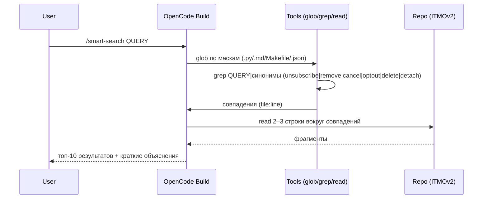

# Design

## Context

Из репозитория ITMOv2 требуется добавить команду `/smart-search` для «умного» поиска без записи и без bash. Поиск по всему проекту (кроме исключений), поддержка синонимов, формат ответа с `file:line`, 2–3 строками контекста и кратким объяснением. Мотивация и цели см. в proposal.md.

## Goals / Non-Goals

Goals:
- Поиск по всему репо с приоритетами `.py > .md > Makefile > .json` и лимитом топ‑10.
- Использовать только инструменты `glob`, `grep`, `read`.
- Поддержка синонимов: `unsubscribe|remove|cancel|optout|delete|detach`.

Non-Goals:
- Индексация, кеши, интеграции, запись артефактов или изменение кода практик.

## Decisions

- Маски включения: `**/*.py`, `**/*.md`, `**/Makefile`, `**/*.json`.
- Исключения путей: `**/node_modules/**`, `**/.venv/**`, `**/__pycache__/**`, `practices/practice_03/lab/results/*.jsonl`.
- Ранжирование: формат → путь → строка. Лимит: 10.
- Отрицательные результаты — явное сообщение + перечисление проверённых масок.

## Risks / Trade-offs

- Без индексации поиск может быть медленнее на больших репозиториях, но остаётся простым и повторяемым.

## Interaction Diagram (Mermaid)

Требование правила: объяснить взаимодействие диаграммой Mermaid.

