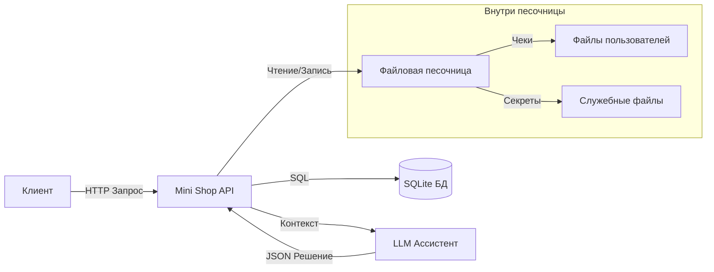

# THREAT MODEL — Mini Shop

## 1. Описание системы

Мини‑сервис интернет‑магазина, развёрнутый локально на `127.0.0.1`. Основные компоненты:

- HTTP‑API на стандартной библиотеке Python (`BaseHTTPRequestHandler`, `ThreadingHTTPServer`).
- База данных: SQLite в памяти (`:memory:`), таблицы `profiles` (PII) и `orders`.
- Аутентификация и сессии: POST `/login` выдаёт UUID‑токен, который передаётся в заголовке `X-Token`; в сессии хранятся `id`, `role`, `username`.
- Файловая песочница (Sandbox): временный корень с каталогами `files/{user}/...` (чеки) и `private/...` (служебные файлы). Доступ к ФС только через методы `Sandbox`.
- Интеграция с LLM‑ассистентом: GET `/assistant/context` формирует подсказку (prompt) по заказам и отзывам; POST `/assistant/execute` выполняет один из «инструментов»: `read_file(path)`, `export_profiles()`, `delete_tree(path)`.

Ограничения транспорта: сервер привязан к `127.0.0.1` и не доступен извне без прокси.

## 2. Архитектура (Mermaid)

## 3. Активы

- PII пользователей: имя, email, адрес (таблица `profiles`).
- Финансы: содержимое каталога товаров (`products`) и цены заказов (`orders`).
- Пользовательские файлы: чеки в `files/{user}/receipt.txt`.
- Секреты/служебные файлы: `private/operator-note.txt`.
- Сессии и роли: токены `X-Token`, `role` (`customer`/`staff`).
- Логи запросов: `/debug/logs`.

## 4. STRIDE — ключевые угрозы и уязвимости

Ниже — исходные уязвимости до фиксов (см. подробности в REPORT_01.md) и их влияние.

| Категория STRIDE | Конкретная уязвимость | Вектор/эндпойнт | Влияние |
|---|---|---|---|
| Spoofing (подмена личности/роли) | Доверие заголовку `X-Role` | `GET /admin/export` (первоначально проверялось `X-Role` вместо роли из сессии) | Неавторизованный доступ к экспортy PII, обход аутентификации |
| Tampering (изменение данных) | Подмена цены | `POST /orders` (цена бралась из тела запроса) | Покупка по заниженной цене, финансовые потери |
| Information Disclosure | IDOR профиля | `GET /profile?id=...` (чтение по `id` из query без проверки владельца) | Чтение чужих PII (профили других пользователей) |
| Information Disclosure | Path Traversal | `GET /files?user=...&path=../../private/...` | Чтение служебных секретов за пределами каталога пользователя |
| Information Disclosure / Tampering | SQL‑инъекции | `GET /profile`, `GET /search`, `GET /assistant/context` (f‑строки в SQL) | Утечка/подмена данных БД через инъекцию |
| Elevation of Privilege | Prompt/Tool Injection | `POST /assistant/execute` без проверки прав инструментов | Чтение/удаление чужих файлов, экспорт профилей от имени «ассистента» |

Примечание: поверх IDOR и SQLi, совокупные уязвимости могли комбинироваться (например, LLM может быть склонён к выполнению опасного инструмента для чужих путей).

## 5. Меры защиты (митигации)

Реализованы в актуальной версии `service.py` (см. REPORT_02.md и автотесты):

- Проверка сессий и авторизации:
  - `/profile` и `GET /orders` используют только `session["id"]`; доступ к чужим данным закрыт.
  - `/admin/export` проверяет `session["role"] == "staff"`; заголовок `X-Role` игнорируется.
- Параметризация SQL (защита от SQLi):
  - `/profile`, `/search`, `/assistant/context` переведены на параметризованные запросы (`?`, `self.db.execute(sql, params)`).
- Защита цены (anti‑tampering):
  - `POST /orders` берёт цену только из каталога `self.products[product]`, независимо от тела запроса.
- Ограничение файловых операций и Path Traversal:
  - `GET /files` разрешает чтение только в `files/{session_user}/...` и требует валидную сессию.
  - В ассистенте `read_file` и `delete_tree` жёстко якорятся на `files/{session_user}/...`; пути нормализуются через `Sandbox.path`, доступ к чужим каталогам запрещён.
- Снижение prompt injection и ограничение инструментов ассистента:
  - `export_profiles` в ассистенте — только для роли `staff`.
  - Данные в `/assistant/context` обёрнуты в теги (`<review_data>`, `<order_data>`, `<user_question>`), снижая риск интерпретации данных как инструкций.
- Тестирование и верификация:
  - Добавлены и обновлены юнит‑тесты, подтверждающие блокировку атак (IDOR, X‑Role spoof, price tampering, path traversal, ограничения ассистента). Все тесты проходят.

Итог: закрыты IDOR, SQL‑инъекции, подмена роли через заголовок, подмена цены, path traversal и несанкционированные операции инструментов LLM. Базовый функционал (покупки по каталогу, отзывы, чтение своих файлов) сохранён.
